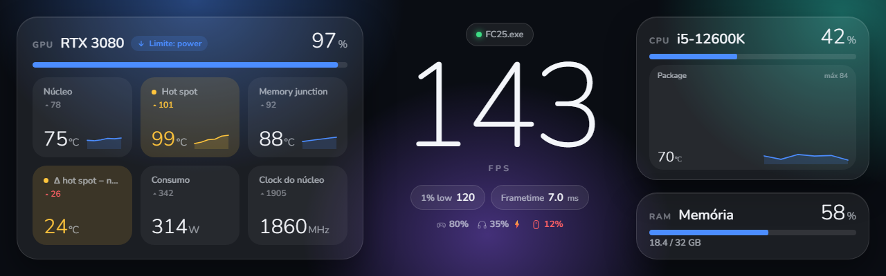
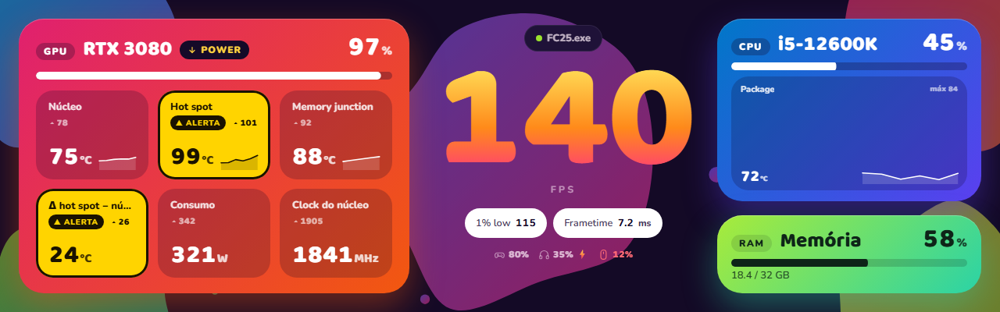
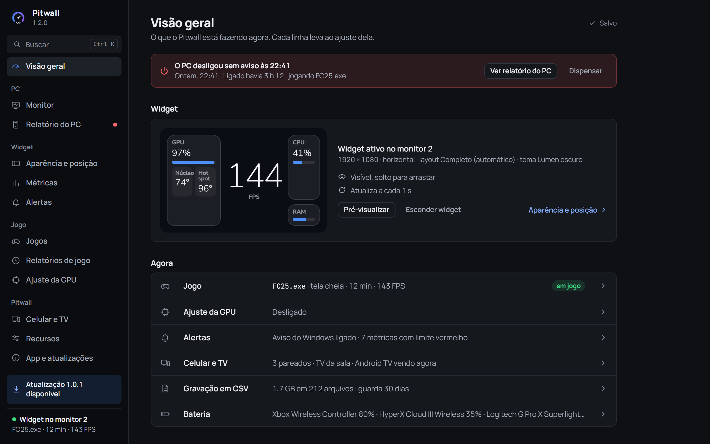
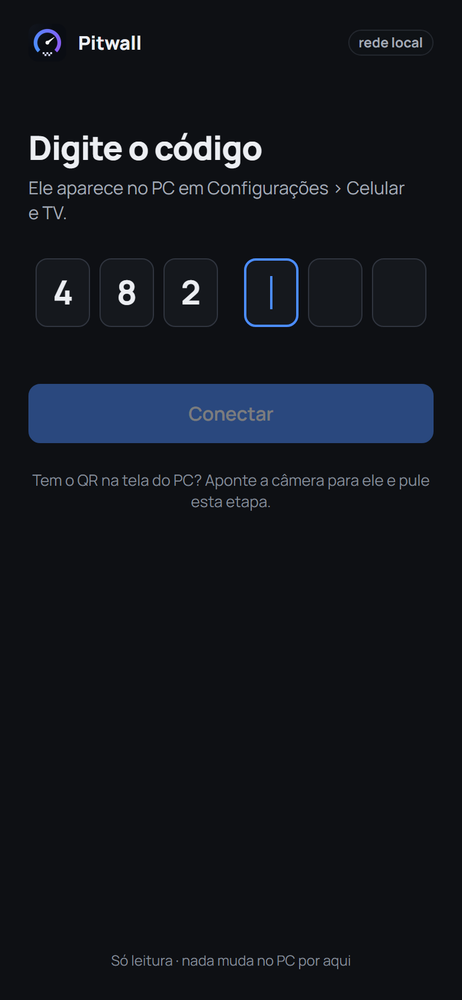
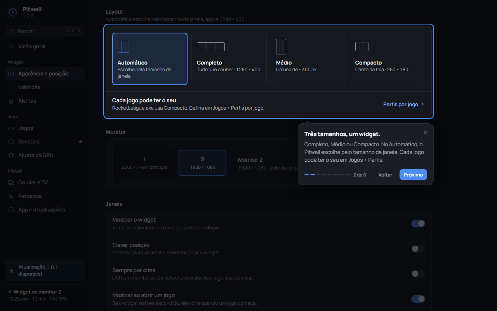

# Pitwall

**English** · [Português](README.pt-BR.md)

A hardware monitor for Windows that shows a widget on a secondary monitor — no overlay, nothing touches the game process.
A lightweight alternative to MSI Afterburner/RTSS: FPS, 1% / 0.1% lows, frametime, temperatures (including GPU hot spot and
memory junction), clocks, power, RAM, wireless mouse/headset battery, a CSV log per game session and optional GPU tuning
(power limit + max clock).

- **Anti-cheat safe:** FPS comes from PresentMon (Windows ETW events); nothing is injected into the game.
- **Lightweight:** ~0.3% CPU for the app + ~1.3% for WebView2, ~50–80 MB.
- **5 themes** (Lumen, Mínimo, Neon, Terminal, Splash), light/dark, and 3 layouts (full, medium, compact).
- **Languages:** English and Portuguese (follows Windows, or pick one in Settings).

## Screenshots




 



More in [docs/screenshots](docs/screenshots) (every widget theme, medium and compact layouts, Settings in light and dark, the TV pairing screen).

## Install

Download `Pitwall-Setup-<version>.exe` from [Releases](../../releases). The installer also sets up:

- [PresentMon](https://github.com/GameTechDev/PresentMon) (Intel, MIT) — FPS capture via ETW.
- [PawnIO](https://pawnio.eu) — signed driver used by LibreHardwareMonitor for CPU sensors (replaces the flagged WinRing0).
- Microsoft WebView2 Runtime, if missing.

Pitwall runs as administrator (sensors and ETW require it). "Start with Windows" uses a Task Scheduler task with highest privileges.

## Architecture

- `src/Pitwall` — .NET 10 WinForms (tray + WebView2 window).
  - Sensors: LibreHardwareMonitorLib 0.9.6 (PawnIO driver).
  - FPS: `tools/PresentMon.exe` read from stdout; FPS, frametime, 1% and 0.1% lows.
  - WebSocket `ws://localhost:48123/ws` (HttpListener, per-run token + origin allowlist) — a snapshot every `refreshMs`.
    Full message reference: [docs/protocol.md](docs/protocol.md).
  - Optional phone view on the LAN (off by default): a separate, read-only server on port 48124 with device pairing.
  - CSV in `%LOCALAPPDATA%\Pitwall\logs`, flushed to disk on every line (useful when the PC crashes); old logs are pruned
    (30 days / 500 MB by default). A crash report shows the last 60 s before an unexpected shutdown.
  - GPU tuning through NVIDIA's official NVML only; restored on exit, on game exit and after a crash.
  - Wireless battery: bundled [WirelessBattery](https://github.com/krisgfx9/Wireless-Device-Battery-Monitor) (built from a
    reviewed commit, plus our AULA driver in `tools/battery-patches`) and [HeadsetControl](https://github.com/Sapd/HeadsetControl).
- `web` — Angular 22: widget (`#/widget`) and settings (`#/settings`), served to WebView2 at `https://pitwall.local`.
- `tests/Pitwall.Tests` — xUnit (`dotnet test`).
- `installer` — Inno Setup script and build scripts.

## Building

Requirements: .NET 10 SDK, Node 24, Inno Setup 6, MinGW-w64 (for the battery reader).

```bash
cd web && npm ci && npx ng build
powershell -ExecutionPolicy Bypass -File installer/fetch-deps.ps1      # PresentMon, PawnIO, WebView2 (pinned, verified)
powershell -ExecutionPolicy Bypass -File installer/build-battery.ps1   # WirelessBattery + HeadsetControl
powershell -ExecutionPolicy Bypass -File installer/build.ps1 -Version 0.7.0
```

Output: `artifacts/installer/Pitwall-Setup-<version>.exe`. GitHub Actions (`.github/workflows/build.yml`) does the same on every
push; a `v*` tag creates a draft release with the installer and SHA-256 checksums.

Useful flags: `Pitwall.exe --dump-sensors [file]` lists every sensor and the mapping. For frontend dev with live data, run
`npx ng serve` and open `http://localhost:4200/?port=48123#/widget` with the app running (`&theme=neon&mode=light&lang=en` to preview).

## Code signing

Releases are **not code-signed yet**, so Windows SmartScreen may warn on first run (*More info → Run anyway*).
Every release is built by the public GitHub Actions workflow in this repository (`.github/workflows/build.yml`) from the
tagged commit, and each release lists the installer's SHA-256 in `SHA256SUMS.txt`; the built-in updater checks that hash
before installing. Third-party programs bundled in the installer keep their own signatures and licenses
(see [installer/THIRD-PARTY-NOTICES.txt](installer/THIRD-PARTY-NOTICES.txt)).

## Privacy

Pitwall does not collect or transfer any personal data and has no telemetry. It only connects to the internet to check
GitHub Releases for updates (no user data is sent; it can be turned off in Settings › App) and, after you agree, to
download the update from GitHub. Sensor data, logs and settings stay on your PC (`%APPDATA%\Pitwall`,
`%LOCALAPPDATA%\Pitwall`). The optional phone/TV view is off by default and only reachable from your local network,
after pairing with a code.

## License

Pitwall's code: [MIT](LICENSE). `tools/battery-patches/` is GPL-3.0 (it modifies WirelessBattery).
Bundled third-party programs keep their own licenses — see [installer/THIRD-PARTY-NOTICES.txt](installer/THIRD-PARTY-NOTICES.txt).
