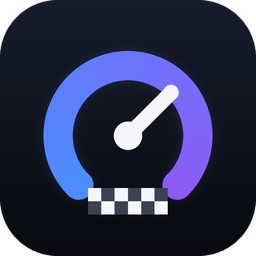
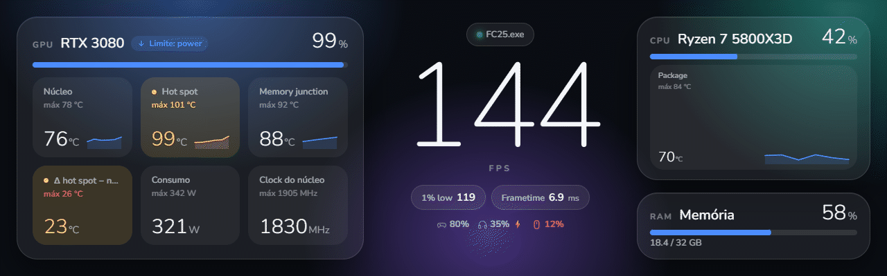
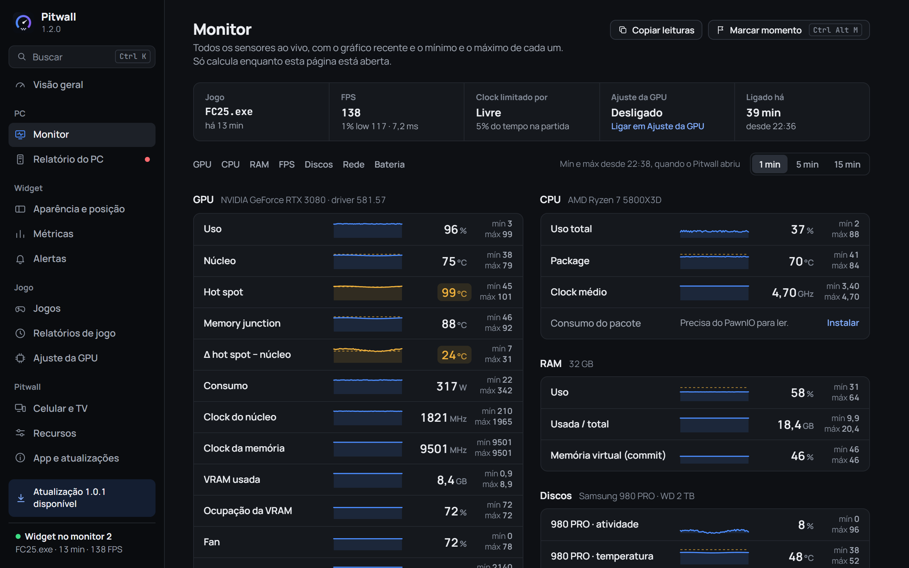
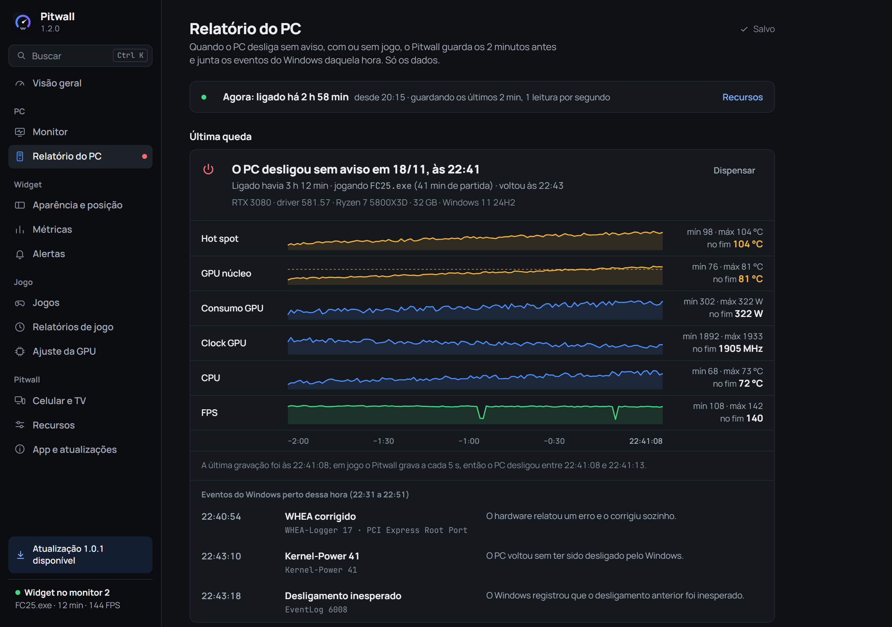
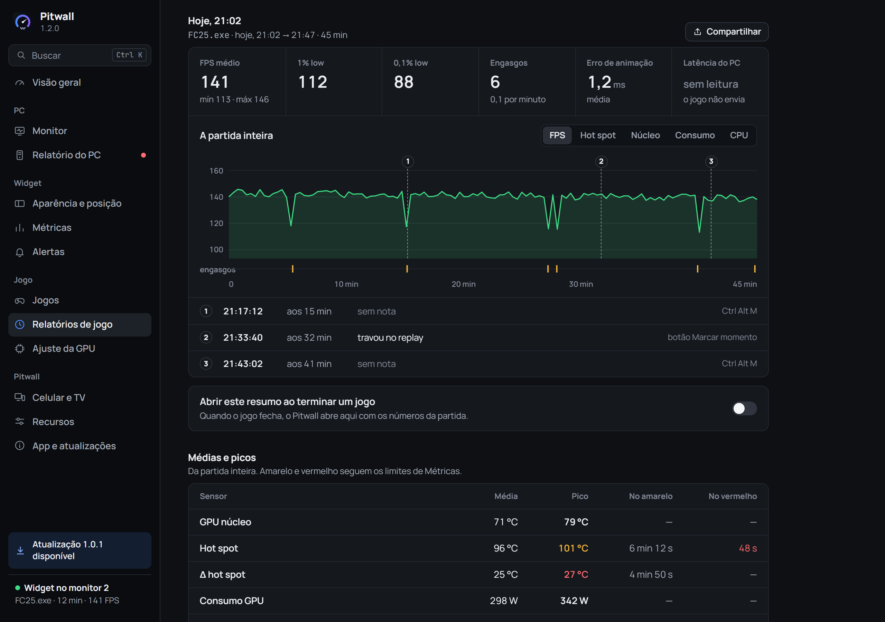
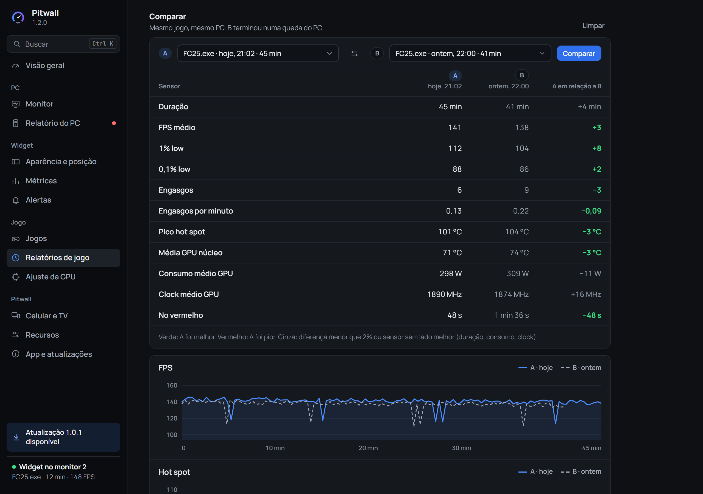
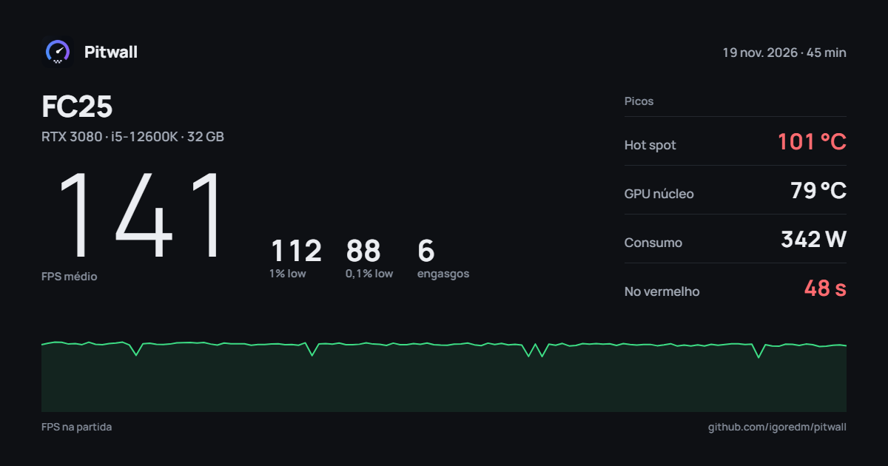
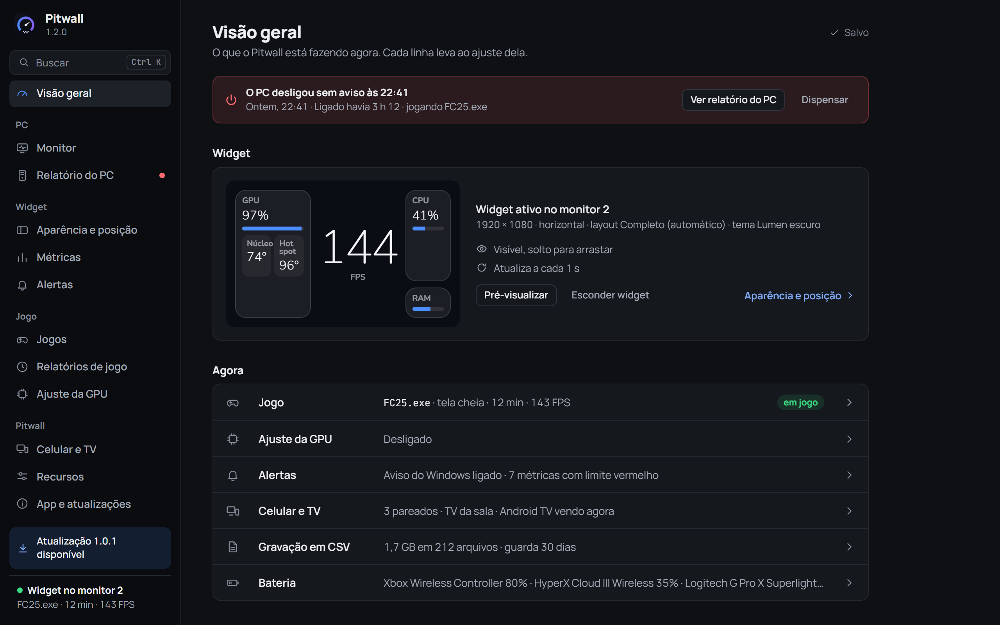
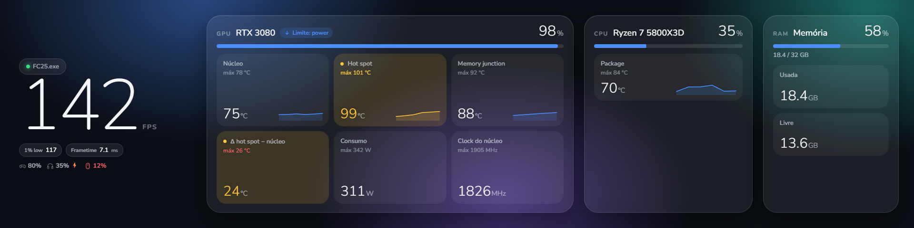
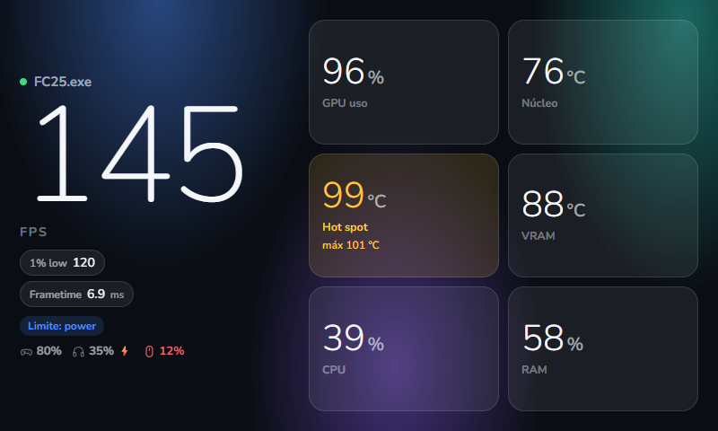

# Pitwall

[English](README.md) · **Português**

Monitor de hardware para Windows que mostra um widget num monitor secundário — sem overlay e sem tocar no processo do jogo.
Uma alternativa leve ao MSI Afterburner/RTSS: FPS, 1% / 0.1% low, frametime, temperaturas (incluindo hot spot e memory junction da GPU),
clocks, consumo, RAM, bateria de mouse/headset sem fio, log CSV por sessão de jogo e ajuste opcional da GPU (power limit + clock máximo).

- **Seguro para anti-cheat:** o FPS vem do PresentMon (eventos ETW do Windows); nada é injetado no jogo.
- **Leve:** ~0,3% de CPU no app + ~1,3% no WebView2, ~50–80 MB.
- **5 temas** (Lumen, Mínimo, Neon, Terminal, Splash), claro/escuro, e 5 layouts (completo, médio, compacto, além de
  **faixa** para telas ultrawide em barra e **mini** para telinhas de 5–8").
- **Monitor:** todos os sensores ao vivo, com gráfico recente, mínimo/máximo e o motivo quando um sensor não tem leitura.
- **Relatório do PC:** quando o PC desliga ou dá tela azul, os últimos 2 minutos de leituras e os eventos do Windows daquela hora.
- **Relatórios de jogo:** cada partida com FPS, engasgos, marcadores e temperaturas; compare duas partidas ou compartilhe um card PNG.
- **Atalhos** (mostrar/esconder o widget, marcar momento) e uma API só leitura para o **Home Assistant**.
- **Idiomas:** português e inglês (segue o Windows, ou escolha nas configurações).
Spec: [docs/spec.md](docs/spec.md) · Design: [docs/design-notes.md](docs/design-notes.md)

## Capturas de tela



| | |
|---|---|
|  |  |
|  |  |
|  |  |
|  |  |

Mais em [docs/screenshots](docs/screenshots) (todos os temas do widget, layouts médio e compacto, Configurações no claro e no escuro, parear celular e TV, o tour da primeira execução).

## É seguro?

Resumo: o Pitwall só lê. Ele nunca toca no jogo, e tudo o que roda é código aberto, compilado num CI público.

- **Anti-cheat:** sem overlay, sem injetar DLL e sem ler a memória do jogo. O FPS vem dos eventos ETW do Windows pelo
  PresentMon da Intel, os mesmos dados que o Windows já produz para qualquer app. Testado todo dia com o EA FC (EA
  Javelin). Nenhum anti-cheat certifica programas de terceiros, mas não há nada no processo do jogo para ele detectar.
  Se um anti-cheat bloquear o ETW, o Pitwall mostra "FPS —" com o motivo e continua com as temperaturas.
- **Por que administrador:** os sensores de CPU e placa-mãe (pelo driver assinado [PawnIO](https://pawnio.eu)), a sessão
  ETW do FPS e o limite de consumo opcional da NVIDIA exigem isso. "Iniciar com o Windows" usa uma tarefa do Agendador,
  então não aparece o UAC a cada boot.
- **Ainda sem assinatura digital:** o SmartScreen pode avisar na primeira vez (*Mais informações → Executar assim mesmo*).
  Todo instalador é compilado pelo [workflow público do GitHub Actions](.github/workflows/build.yml), e o SHA-256 dele está
  no `SHA256SUMS.txt` da release. O atualizador confere esse hash antes de instalar.
- **O ajuste da GPU vem desligado** e usa só a API oficial da NVIDIA (NVML). Nada é gravado na placa: os limites voltam
  ao normal quando o jogo ou o Pitwall fecha (e, depois de uma queda, ao abrir de novo).
- **Rede:** sem telemetria e sem conta. A única conexão de saída é a busca por atualização no GitHub. A visualização no
  celular/TV e o endpoint do Home Assistant vêm desligados, funcionam só na rede local e são só leitura.
- **Achou um problema?** Veja o [SECURITY.md](SECURITY.md) (o relato privado de vulnerabilidade está ativo).

## Arquitetura

- `src/Pitwall` — .NET 10 WinForms (bandeja + janela WebView2), roda como administrador.
  - Sensores: LibreHardwareMonitorLib 0.9.6 (driver **PawnIO**, sem WinRing0).
  - FPS: `tools/PresentMon.exe` (Intel, ETW) lido pelo stdout; FPS, frametime, 1% e 0.1% low.
  - WebSocket `ws://localhost:48123/ws` (HttpListener, token por execução + Origin) — snapshot a cada `refreshMs`.
    Referência das mensagens: [docs/protocol.md](docs/protocol.md).
  - Visualização opcional no celular pela rede local (desligada por padrão): servidor separado, somente leitura, porta 48124,
    com pareamento por QR.
  - CSV em `%LOCALAPPDATA%\Pitwall\logs`, todas as métricas disponíveis, `FlushFileBuffers` por linha; logs antigos são
    apagados (padrão 30 dias / 500 MB). Relatório de crash com os últimos 60 s antes de um desligamento inesperado.
  - Iniciar com o Windows: Agendador de Tarefas com "privilégios mais altos".
- `web` — Angular 22: widget (`#/widget`) e configurações (`#/settings`, carregada sob demanda), 5 temas
  (Lumen, Mínimo, Neon, Terminal, Splash) com tokens em `src/styles.scss`. Servido ao WebView2 via `https://pitwall.local`.
  - Métricas "Outros" (discos, placa-mãe, rede) só são lidas do hardware quando habilitadas.
- `installer` — Inno Setup: inclui PresentMon e instala PawnIO e WebView2 Runtime se faltarem.

## Desenvolvimento

```bash
cd web && npx ng build          # frontend -> web/dist (copiado para wwwroot no build .NET)
cd src/Pitwall && dotnet build  # app; rodar bin/Debug/.../Pitwall.exe (pede UAC)
```

- `Pitwall.exe --dump-sensors [arquivo]` lista todos os sensores e o mapeamento.
- Dev do frontend com dados ao vivo: `npx ng serve` e abrir `http://localhost:4200/?port=48123#/widget` com o app rodando.
  Pré-visualizar outro tema sem mudar a config: `?port=48123&theme=neon&mode=light#/widget`.
- Em Debug, `{"type":"quit"}` no WebSocket fecha o app (o processo é elevado).

## Instalador

```bash
powershell -ExecutionPolicy Bypass -File installer/fetch-deps.ps1      # PresentMon, PawnIO, WebView2 (versões fixas, verificadas)
powershell -ExecutionPolicy Bypass -File installer/build-battery.ps1   # WirelessBattery (requer MinGW) + HeadsetControl
powershell -ExecutionPolicy Bypass -File installer/build.ps1 -Version 0.7.0
```

Gera `artifacts/installer/Pitwall-Setup-<versão>.exe`.

O GitHub Actions (`.github/workflows/build.yml`) faz o mesmo a cada push; uma tag `v*` gera um rascunho de release com o instalador.

## Assinatura de código

As releases **ainda não são assinadas**, então o SmartScreen do Windows pode avisar na primeira execução
(*Mais informações → Executar assim mesmo*). Toda release é compilada pelo workflow público do GitHub Actions deste
repositório (`.github/workflows/build.yml`) a partir do commit da tag, e cada uma traz o SHA-256 do instalador em
`SHA256SUMS.txt`; o atualizador confere esse hash antes de instalar. Os programas de terceiros incluídos no instalador
mantêm suas próprias assinaturas e licenças (ver [installer/THIRD-PARTY-NOTICES.txt](installer/THIRD-PARTY-NOTICES.txt)).

## Privacidade

O Pitwall não coleta nem envia dados pessoais e não tem telemetria. Ele só acessa a internet para procurar atualizações no
GitHub Releases (nenhum dado do usuário é enviado; dá para desligar em Configurações › App) e, depois que você aceita, para
baixar a atualização do GitHub. Sensores, logs e configurações ficam no seu PC (`%APPDATA%\Pitwall`,
`%LOCALAPPDATA%\Pitwall`). A visualização no celular/TV vem desligada e só funciona na sua rede local, depois de parear
com um código.

## Licença

Código do Pitwall: [MIT](LICENSE). `tools/battery-patches/` é GPL-3.0 (modifica o WirelessBattery).
Programas de terceiros empacotados: ver [installer/THIRD-PARTY-NOTICES.txt](installer/THIRD-PARTY-NOTICES.txt).
